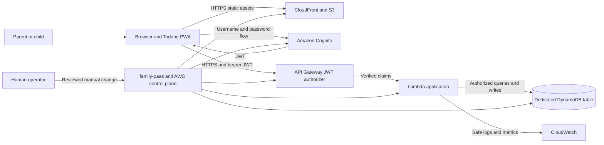

# System Context

## Purpose

Todone is a private family task-tracking progressive web application (PWA). It serves a small number of parents and children, but it treats household data as private multi-tenant data. The initial deployment has one production environment and no staging environment.

This document defines system responsibilities and trust boundaries. Product behavior is specified in `docs/product/` and the applicable OpenSpec changes.

## People and external systems

| Actor or system | Responsibility |
| --- | --- |
| Parent | Manages household accounts and Todos as allowed by delivered capabilities. |
| Child | Views and completes authorized Todos and manages only their own profile. |
| Operator | Reviews plans, authorizes production changes, performs deployment, rollback, restore, and identity repair. |
| Browser/PWA | Renders the application, authenticates with Cognito, and calls the API with a JWT. It is not trusted to enforce authorization. |
| Amazon Cognito | Authenticates immutable, case-insensitive usernames, issues JWTs, retains verified parent recovery email, and sends low-volume transactional account email through its built-in sender. Cognito `sub` is the stable identity. |
| CloudFront and S3 | Deliver versioned static PWA assets over HTTPS. |
| API Gateway | Terminates the public API boundary and rejects invalid JWTs before protected handlers execute. |
| Lambda | Validates requests, resolves membership, enforces role and household authorization, and performs application operations. |
| Dedicated DynamoDB table | Stores Todone application data and access-pattern projections with point-in-time recovery enabled. |
| CloudWatch | Receives privacy-safe structured operational logs and aggregate health metrics. It is not a product analytics system. |
| `family-paas` | Separately owned infrastructure source that provisions and exposes the AWS resources Todone requires. |

## Runtime context

## Trust boundaries

1. **Device boundary:** Browser storage, JavaScript state, routes, identifiers, clocks, and form values are attacker-controlled. The service worker MUST NOT cache protected API responses. A valid UI state is never proof of authorization.
2. **Public network boundary:** Static assets, Cognito endpoints, and API Gateway are internet reachable. All traffic MUST use HTTPS. CORS narrows browser origins but is not an authorization control.
3. **Authentication boundary:** Cognito validates credentials and API Gateway validates a configured token issuer and audience. A valid JWT proves an identity, not household membership, role, target ownership, or resource state.
4. **Application authorization boundary:** Lambda derives identity from the verified token and resolves active membership server-side before every household operation. Client-supplied household, member, Todo, label, or template identifiers never grant access.
5. **Data boundary:** The Todone runtime role can access only the dedicated Todone table and explicitly approved Cognito administration actions. Product handlers cannot read restricted audit snapshots through product APIs.
6. **Operations boundary:** Terraform and AWS control-plane credentials remain outside the application. Production apply, deploy, rollback, restore, identity repair, and destructive account operations require an explicitly authorized human.
7. **Observability boundary:** Logs and metrics may contain request ID, route template, status, latency, and coarse outcome. They MUST NOT contain passwords, setup secrets, JWTs, recovery email addresses, names, profile values, Todo content, labels, or raw request/response bodies.

## Runtime responsibilities

The PWA is responsible for presentation, accessible interaction state, session initiation/restoration, and sending tokens only to the configured API origin. It may perform convenience validation, but server validation remains authoritative.

`src/main.ts` creates one app session controller and injects it into the router and Vue tree.
The controller owns credential restoration, current membership/profile context, identity
generation, and sign-out. Router guards share its initialization and read ready context without
calling Cognito, membership, or profile endpoints on navigation. The session root gates unresolved
or denied context before private presentation and reconciles role/onboarding destinations.
Bootstrap and Todo pages no longer construct providers or use a route-to-page handoff.
Registration/confirmation/recovery use the same account adapter while secrets remain form-local.
Confirmed household/profile writes update controller context directly.

Pages own feature requests (such as the family directory), safe editable drafts, mutation
idempotency keys, and destination focus. Those requests still use server authorization; controller
state grants no access. Routine route changes may load feature data but never restart session
resolution. Profile drafts survive ordinary in-app navigation and are discarded on explicit
cancel or identity loss. Identity replacement/sign-out removes private surfaces and rejects old
page results/navigation.

The controller coalesces renewal within a 60-second expiry margin and checks foreground context
at most once per five minutes. Authenticated requests acquire credentials when sending; safe
reads have at most one renewal retry, while mutations are never automatically replayed. Transient
background failures retain confirmed content and drafts; authoritative loss clears private state.

A versioned localStorage adapter persists only allowlisted SDK authentication material for one
account per origin/browser profile. Web Locks serialize short generation publication and cleanup;
provider network waits remain outside locks. BroadcastChannel and storage events contain only
change hints, never credentials or identity. Tabs reread authoritative storage on hints and before
revealing private content after suspension. Immutable credential namespaces, generation checks,
and aborted requests reject late results after account replacement or sign-out. Sign-out clears
private UI immediately and publishes a shared tombstone even if SDK cleanup fails. Storage or
coordination denial is an explicit recoverable error. Legacy tab credentials are cleared without
promotion; see ADR 0007 and the deployment/rollback handoff.

Development-only session diagnostics allow only operation, coarse outcome, and elapsed time.
No provider messages, tokens, account identifiers, or private context enter those events; the
production controller adds no remote telemetry.

API Gateway is responsible for JWT authentication on protected routes. Lambda is responsible for input validation, household and role authorization, lifecycle constraints, conflict detection, privacy-safe errors, and persistence.

Cognito's built-in sender owns first-parent verification/recovery and additional-parent invitation
delivery. The reviewed static invitation template is infrastructure configuration; Todone does not
run an SES sender or custom-message Lambda. The deployment accepts Cognito's 50-message daily AWS
account quota and requires a later reviewed architecture change before introducing SES.

Privileged family-account handlers use the typed adapter in
`lambdas/cognito/administration.ts`. It exposes only user creation/resend, pending-parent email
update/verification, permanent child password replacement, user deletion, and global sign-out.
Dependency failures become safe domain errors that retain no AWS message or metadata. These future
handlers must explicitly use the separate family-account Lambda role; ordinary session,
Membership, profile, and directory handlers retain a role with no Cognito administration access.
The privileged role is restricted to those five Cognito IAM actions on the one Todone user-pool
ARN.

DynamoDB is the durable application store. Queries MUST follow the access patterns in `data-model-and-access-patterns.md`; table scans are not a normal request path. Point-in-time recovery is a recovery control, not an application history feature.

## Deployment context

- There is one production environment. Local simulation and automated tests are the pre-production verification environments.
- Production deployment is manual and reviewed. Passing CI does not authorize deployment.
- An agent MUST NOT run a production plan that changes resources, apply infrastructure, publish application artifacts, invalidate production caches, create production users, run a production restore, or execute a live smoke test without explicit human authorization.
- Prior frontend and Lambda artifacts are retained so an operator can roll back application code.
- Replacing the existing shared Cognito pool is allowed only after an immediate pre-apply check proves it has no users and no active consumers.

See `docs/operations/deployment-rollback.md`, `docs/operations/backup-restore.md`, and `family-paas-handoff.md` for operational contracts.

## Scope boundaries

The production bootstrap provides first-parent registration, recovery, shared browser-account restoration, and the initial Household/parent Membership boundary. Later account-management, Todo, label, history, and recurrence behavior enters only with its owning OpenSpec change.

Native iOS packaging, offline mutation queues, third-party integrations, notifications, telemetry, behavioral tracking, and automatic production deployment are out of scope.
