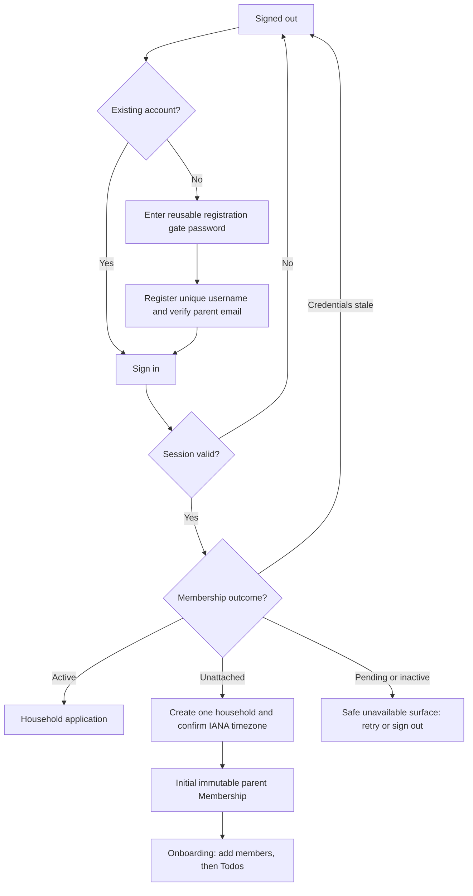
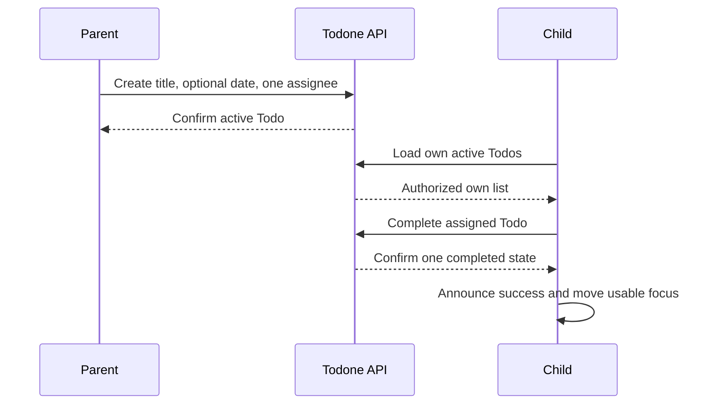

# Global User Flows

## Flow rules

- The API, not the UI, decides household and role authorization.
- Every remote step has loading, success, empty where applicable, recoverable error, retry, disabled/submitting, and signed-out/session-expired behavior as defined in `interaction-states.md`.
- A return visit restores the current session when valid, resolves active Membership, and routes by membership and onboarding state.
- The application never exposes another household while resolving an invalid route or resource ID.

## Production session and first household

- The reusable registration gate password permits creation of an unattached first-parent account. It does not join or reveal an existing household, and Cognito credentials remain the authentication control.
- The first parent verifies a recovery email before onboarding is complete.
- An authenticated account without Membership can create exactly one new household. Creation is atomic from the user's perspective and safe to retry.
- Browser timezone is a prefill only. The parent confirms a valid IANA timezone or selects one when detection is unavailable.
- Existing members bypass bootstrap. Removed or inactive members are denied even with an otherwise valid session.
- After Membership and Profile resolution, an active child lands on canonical `/todos`. Until the first Todo capability ships, that route clearly says the surface is work in progress and contains no Todo data, Todo controls, or Todo API activity. Parents retain the nearest currently useful authorized landing surface until a real parent Todo home exists.
- Forgot Password is available to parent accounts with verified email. Children use parent-managed reset, not email recovery.
- Return visits, reloads, new tabs, and reopened browser profiles restore the same browser account while provider credentials remain valid. All tabs on this origin share one account; separate browser profiles remain isolated. Legacy tab credentials are cleared without promotion; a tab without valid shared state asks for sign-in once.
- Ready navigation preserves safe drafts and destination focus without repeating session prerequisites. Routine renewal is silent. A transient background failure preserves confirmed content and offers retry; an uncertain write is never replayed automatically.
- Pending activation, inactive membership, and inconsistent access use distinct safe feedback with Retry and Sign out; none routes to household creation. This session change does not deliver the separate pending-parent activation feature.
- Sign-out clears local credentials and private UI/drafts immediately, then returns focus to the signed-out heading. Other open tabs converge to signed out; suspended pages reconcile before revealing private content. SDK cleanup failure cannot keep local access open. A storage failure explains incomplete shared cleanup without redisplaying private content.

## Family account management

1. A parent opens Family Management and sees active members with display name, username, immutable role, profile color, and only permitted actions. Recovery emails are absent.
2. To add a child, the parent chooses a globally unique username, display name, color, and password. Delivery is suppressed; the child can sign in immediately after complete provisioning.
3. To add a parent, the existing parent supplies username, display name, color, and email. The new parent verifies email and chooses their own password before Membership becomes active.
   After Cognito completes the setup-code challenge, the activation API uses only the new parent's
   verified identity to activate the matching pending Membership; an existing parent cannot do it
   for them.
4. Any member can edit only their own display name and profile color.
5. A parent may reset a child password after explicit target identification. The password is never persisted or repeated.

   The child row links to `/family/children/:memberId/password`. The form identifies the child by display name and username, explains that successful reset signs out other devices, and uses the shared password guidance. Cancel returns to Family without mutation. Back/Forward/reload clear the password. A successful reset returns to Family with a persistent confirmation; an uncertain failure clears the password and disables ordinary resubmission. Missing targets return to Family and child callers are redirected to their own Todo landing.
6. A parent cannot reset, remove, demote, or edit another parent.
7. Child removal requires confirmation describing the full deployed cascade. Success invalidates stale sessions, removes child-associated data, and releases the username only after the cascade completes. Cancellation changes nothing.
8. A partial Cognito/application-data failure returns a generic request-ID result that does not
   claim retry is safe. The username or lifecycle operation remains blocked until manual operator
   cleanup; the product exposes no repair UI, automated repair, or monitoring.
9. An authenticated identity with no lookup is routed to household setup. Pending, inactive,
   credential-stale, and inconsistent Membership states are not treated as unattached: pending
   parents remain in activation, stale sessions return to sign-in, and unavailable/corrupt access
   uses a generic safe surface.

## First Todo loop

- Parent creation validates one active household assignee. Cancellation creates nothing; recoverable failure preserves entered non-secret values.
- A child sees only their active Todos. A parent can inspect each household member's active list.
- The assignee or any parent can complete an active Todo. The UI waits for server confirmation and handles duplicate/stale completion as one current result.
- An optional due date is date-only. Overdue begins only after that household-local date ends and remains an active presentation state.

## Todo lifecycle and history

- Parents can edit title, date, and assignee only while a Todo is active.
- The completing child can undo their own completion while the Todo remains assigned to them. Any parent can reopen a completed household Todo through the same versioned transition.
- A parent can archive active or complete work. Restore returns to the exact pre-archive state. Archived work cannot otherwise be changed.
- A parent can explicitly delete active, complete, or archived work after confirmation. It disappears from product views; a restricted audit snapshot is not exposed to product users.
- Children see only their own completed/archived history. Parents see household history. Concurrent changes present current state and refresh/retry guidance rather than silently overwriting.

## Labels

1. During Todo create/edit, a parent selects zero or one existing household label or explicitly creates a new valid label.
2. Suggestions use trimmed case-insensitive prefix matching. Selection and creation are distinct actions.
3. A capitalization-only duplicate is rejected and the existing label is offered for selection.
4. Active and completed Todos may be relabelled or cleared; archived Todos remain immutable.
5. Parent and child active/history views allow one label filter. A child's options may include all household labels, but filtering applies only to that child's already-authorized results. A sibling-only label produces an empty result, not sibling data.

## Recurring rounds

- A parent creates a template for one active household assignee. Daily generation starts at the next local day boundary. Weekly generation starts next Sunday; monthly generation starts next month.
- Server-side scheduling creates one ordinary Todo per template and household-local round key without user login. Reconciliation creates only the current round and never backfills fully elapsed gaps.
- Template edits or retirement affect future rounds only. Existing generated Todos retain their values and history.
- An incomplete rollover-bound round becomes `MISSED`; a parent Archive action makes it irreversibly `SKIPPED`; completed work remains `COMPLETED`.
- Editing a generated due date or reopening/undoing a completed generated round detaches it from rollover and returns it to ordinary active work until resolved.
- A parent may correct `MISSED` to `COMPLETED`; children cannot alter missed or skipped outcomes.
- History remains chronological and uses explicit status text. There is no trends, aggregation, chart, or missed-first surface.
- Weekly/monthly implementation remains blocked until daily recurrence is implemented, locally verified, deployed through its approved process, and accepted.

## Global interruption and recovery

- **Session renewal ends:** Renew silently before expiry when possible. If credentials are terminally invalid, stop protected writes, clear private rendered data, preserve only safe navigation intent, and route to sign-in with an announced explanation. Never replay a secret-bearing request automatically.
- **Network fails:** Keep current confirmed data visible, identify potentially stale content, and offer retry. Do not claim a mutation succeeded.
- **Conflict occurs:** Show current authorized state, explain that another change won, and offer refresh or a new action based on that state.
- **Access is removed:** Clear household state and route to a generic unavailable/signed-out surface without naming the removed household or resource.
- **Deployment updates the PWA:** Do not interrupt an in-progress form. Offer a controlled refresh after the new shell is ready and ensure protected API data was not service-worker cached.

## Visual-foundation UX journeys

These journeys exercise the real local application after the visual-foundation implementation. They do not use the retained reference page.

1. **Signed out:** Start at `/` with no session. Verify one visible Todone heading, the focused skip link reaches main content, the sign-in surface uses readable warm paper treatment, and Entry Code appears only after choosing account creation. Tab through the form: every control shows a visible focus indicator and remains at least an ordinary touch-target size.
2. **Onboarding parent:** Use a first-parent account with no Membership, complete household setup, then profile setup. Verify validation/error copy remains associated with its fields; selecting a profile color shows the named swatch plus label; successful profile save reaches `/family` with the profile tone applied to the app shell and no changed security or onboarding behavior.
3. **Active parent:** Sign in as an active parent with a Profile and go to `/family`. Verify the application navigation offers Family and My profile, does not offer unavailable Todo creation/history actions, retains logical reading order at compact and wide widths, and profile editing preserves focus/validation behavior.
4. **Active child:** Sign in as an active child with a Profile and verify `/todos` is the landing route. Confirm application navigation offers My Todos and My profile, the work-in-progress surface is profile-toned but contains no fabricated Todo, no completion/create action, and no Todo API request. Toggle reduced motion in browser settings and verify the same route, text, focus, and reading order remain without non-essential movement.
