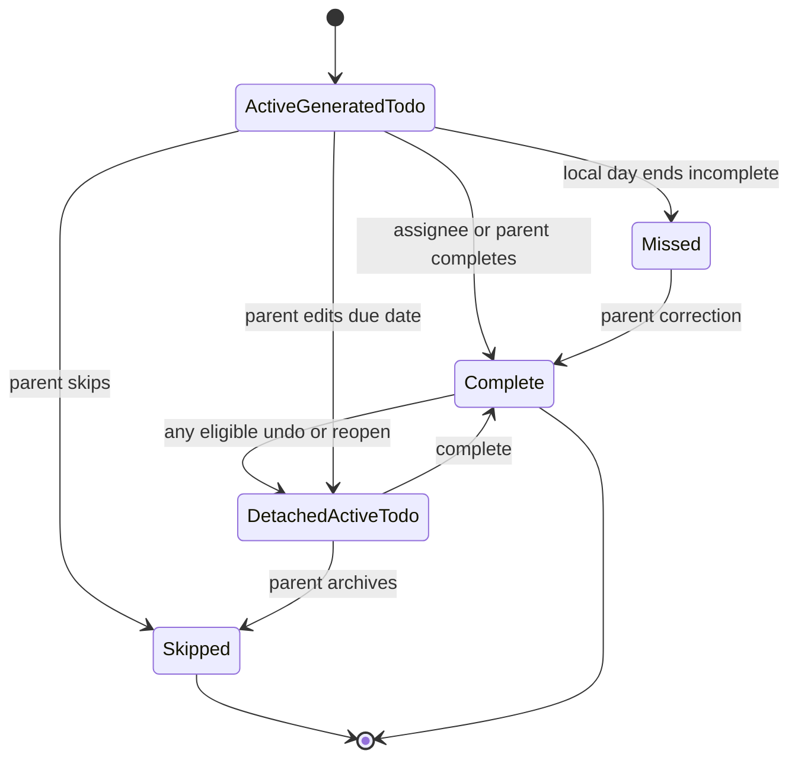

## Context

Daily recurrence is explicitly post-MVP. A recurrence template schedules ordinary dated Todo records. Generated Todos use the established lifecycle and product deletion behavior, with recurrence-only `MISSED` and `SKIPPED` outcomes so prior rounds remain useful history without intruding on today's work.

## Goals / Non-Goals

**Goals:** daily templates, household-local generated Todos, idempotent rollover, server-side current-round recovery, and non-actionable historical rounds.

**Non-Goals:** weekly/monthly recurrence, arbitrary schedules, elapsed-round backfill, ordered routine checklists, push notifications, rewards, skip reversal, and retroactive child completion.

## Decisions

- Keep RecurrenceTemplate separate from Todo. A template supplies future generation values; each round creates an ordinary Todo with template ID and household-local date round key metadata.
- Derive uniqueness from template ID plus local date. A template created during a day becomes effective at the next local day boundary.
- Run generation server-side on a schedule independent of user reads. A server-side reconciliation path creates only the current round when needed; it does not backfill elapsed dates.
- Use Household timezone stored at bootstrap, never browser-local timezone, for date boundary calculations.
- Template create/edit/remove affects future generation only. Remove retires the template while retaining identity required by existing Todo history.
- Generated Todos use ordinary validation, edit, completion, label, and product-deletion behavior where their current lifecycle permits. `MISSED` and `SKIPPED` are recurrence-only historical outcomes; their metadata is immutable.
- Ordinary Archive on a rollover-bound active generated Todo means `SKIPPED`, records no reason, and is irreversible. Archive on an already detached active Todo also resolves it as skipped. Parent missed correction replaces `MISSED` with `COMPLETED`, recording the parent and correction time.
- Editing a generated Todo's due date or reopening/undoing any completed generated round sets a rollover-detached flag. The Todo preserves template/round provenance but behaves as ordinary active work in the default list and is not auto-missed.
- Children see only their current generated Todos in active views and their own prior outcomes in history.
- Member history remains chronological and gives `MISSED` an explicit text label plus restrained red warning. No trends dashboard, aggregation, date filters, special sorting, or chart is introduced.
- Reuse existing privacy-safe logs and free CloudWatch metrics. Do not provision paid alerting or monitoring resources for recurrence.
- Extend the child-removal cascade with RecurrenceTemplate, generated Todo, recurrence-history, and associated audit-snapshot deletion before identity deletion and username release complete.

## Visual and UX Direction

- Extend `visual-design-foundation` and the accepted Todo-row/history anatomy. Generated Todos should look like ordinary current work with compact recurrence context; template management is a parent tool and must not create a visually separate child experience.
- Explore daily-template list/create/edit/retire states, current generated work, missed/skipped/completed history, correction, detachment, generation failure, and retry before implementation. Use progressive disclosure for schedule and lifecycle explanation so the common title/assignee/label fields remain easy to scan.
- Keep recurrence provenance and outcome as secondary text with consistent placement. `MISSED` and `SKIPPED` require explicit labels; the restrained red missed treatment is supplementary and never becomes a large alarming card.
- Reopening or due-date editing should clearly explain that the Todo becomes ordinary active work without turning the row into a special exception design. Template retirement should read as future-facing and preserve visible history context.
- Reuse the brief server-confirmed nature-treatment completion celebration for a current generated Todo only. Historical corrections, skips, retirement, rollover, and reconciliation use calm state feedback rather than celebratory motion.
- Review compact and wide compositions with long titles, schedule metadata, error/retry, chronological history, reduced motion, zoom/reflow, and keyboard/screen-reader use before completing the UI.

## Risks / Trade-offs

- Scheduled execution may fail or run late; current-round reconciliation repairs present work, while accepted elapsed gaps remain absent from history.
- Daylight-saving transitions require date arithmetic in the household IANA timezone rather than fixed 24-hour intervals.

## Migration Plan

- Introduce templates and generated-Todo metadata without changing one-off Todo behavior.
- Release daily creation and query behavior before enabling the schedule.
- Roll back the schedule safely; existing generated Todos remain ordinary current or historical Todo records.

## Child-removal extension contract

Register every child-associated record/history/audit type introduced here in
`lambdas/households/childRemoval.ts` (`childRemovalSteps`) and add deletion and partial-failure
coverage before this capability is complete. Keep profile/lifecycle writes conditional on active
Membership so late writers cannot recreate purged data. The approved hash-only revocation marker
blocks stale-token bootstrap after lookup deletion and expires after confirmed Cognito deletion
plus configured token lifetime/tolerance; never retain raw removed-child identity or snapshots.

## Required central authorization integration

Delivered protected operations must extend `shared/authorizationCapabilities.ts` and the central
policy. Register a stable key, eligible principals, trusted household/self/target scope and
lifecycle restrictions before implementation; do not recreate role/state authorization in
handlers, repositories or UI. Update the authorization matrix and add policy tables plus endpoint
security-negative/side-effect-order tests. Broad capabilities and contextual `allowedActions` are
server-produced presentation hints only. Preserve conditional writes, scoped queries and
non-disclosing denials. Completed retries require caller-bound completed-receipt decisions, never
new side effects against missing targets. Service/scheduler principals need an explicit separate
policy boundary and must not inherit user grants.
