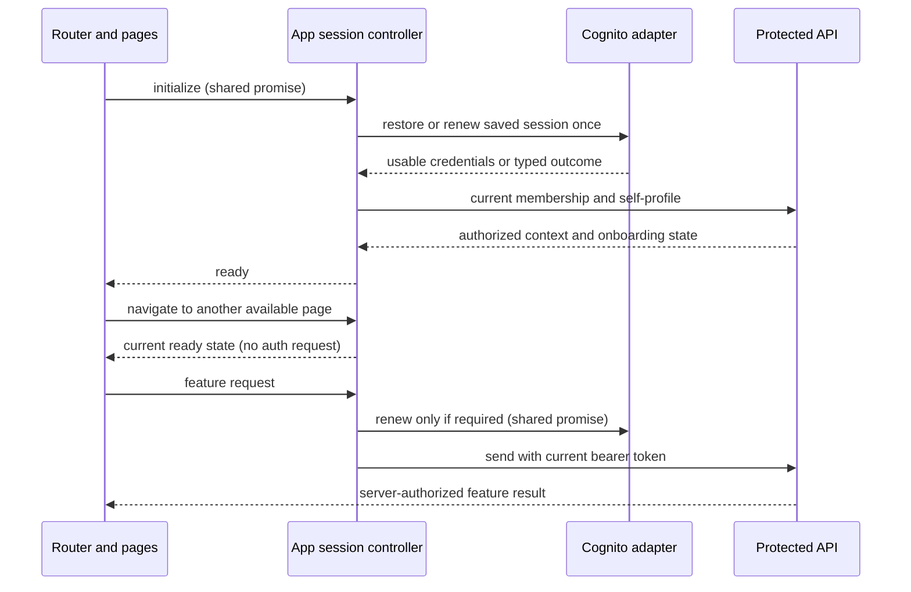

# Design

## Context

See proposal.md for the user problem. `AuthClient` currently constructs Cognito pools with sessionStorage. Router guards construct a new client, restore credentials, and fetch membership/profile on each navigation. `ProductionBootstrap` also owns authentication and onboarding. A one-use `routeBootstrapContext` now prevents repeat work on mount, but leaves session ownership fragmented. The current storage policy is normative in household-membership and the threat model; this change explicitly replaces it.

ADRs 0002 and 0004 still govern Cognito stable identity and server-side membership authorization. No server session store or new auth endpoint is required. The deployed clients' configured token/refresh lifetimes remain unchanged. Development Cognito is a separate adapter with documented parity limits.

## Goals / Non-Goals

**Goals:** one lifecycle owner per app instance; shared browser-account persistence; no auth work caused by routine ready navigation; quiet renewal; bounded context freshness; reliable identity invalidation; explicit startup/error recovery; a small testable replacement for the temporary handoff.

**Non-Goals:** application-wide feature-data caching, authorization-policy redesign, a new state-management dependency, server sessions, cookie authentication, offline mutation replay, account-switcher UI, provider lifetime changes, or production operations.

## Decisions

### One controller, created at the app composition root

Add a framework-light session controller with readonly reactive state, created once by `src/main.ts` and injected into router, app shell, page composition, and authenticated-request dependencies. Keep the existing Cognito library behind `AuthClient` as a provider adapter. Consumers do not instantiate their own providers, restore sessions, or own token lifetimes. Tests construct isolated controllers with fake clock/provider/storage/request boundaries.

The controller owns initialization, sign-in adoption, credential renewal, current membership/self-profile context, invalidation, sign-out, and disposal. Registration/verification/recovery retain their existing provider calls and field-level contracts but use the shared adapter; passwords/codes remain form-local and are cleared on existing boundaries. Pages continue owning feature data and editable drafts.

Suggested operations are `initialize`, `signIn`, `ensureUsableCredentials`, `refreshContext`, `applyConfirmedProfile`, `applyConfirmedMembership`, and `signOut`. Expose domain state and stable result types, never raw provider errors or token values to templates. The authenticated-request helper obtains credentials at send time; an old token is not captured permanently in a client or component closure.

A global event bus without ownership was rejected because it would leave duplicate initialization and invalidation paths. A new store library is unnecessary for this scope.

### Explicit state and one pending operation of each kind

Primary states are uninitialized, initializing, signed-out, ready, and recoverable-error. Ready context distinguishes unattached identity, profile-required, and active member. Preserve typed pending/inactive/credential-stale/inconsistent outcomes from membership contracts instead of treating them as no membership. Background refresh/renewal is activity within the current ready state, not a replacement page state.

Owner decision on 2026-10-19: extend `GET /api/v1/memberships/current` rather than preserve its existing generic pending/inactive denial. For the verified caller only, return `403 MEMBERSHIP_PENDING_ACTIVATION`, `403 MEMBERSHIP_INACTIVE`, or `500 MEMBERSHIP_INCONSISTENT`; retain `401 SESSION_REAUTHENTICATION_REQUIRED` for credential cutoff and `200 {membership: null}` only for unattached identities. Error bodies retain the shared no-store envelope, safe catalog messages, and request ID without identity/household/target details. Ordinary protected-operation and target denials keep their current contracts. Unknown server/network failures remain recoverable errors, never inferred membership states. Centralize these codes in a shared external contract catalog and test them through real authorization boundaries before the controller consumes them. Pending does not enable an undelivered activation feature; provide the existing unavailable/recovery treatment until its owning capability ships.

Memoize initialization, renewal, and context-refresh promises separately. Clear pending references in finally blocks. Every asynchronous operation captures an identity generation; a result can update current state only if that generation remains current. A newer sign-in, sign-out, peer invalidation, or disposal cancels/invalidates earlier operations. Abort supported fetches and discard other late results. Do not use arbitrary delay timers to hide loading flashes.

### Ready navigation reads state; API authorization remains authoritative

Router guards await initialization only when unresolved, then choose routes from controller state. A ready navigation does not call Cognito, membership, or profile endpoints. Keep canonical URLs, safe deep links, Back/Forward, role-appropriate landing, and destination-heading focus. The controller's memory is presentation context, not an authorization cache trusted by the server.

Page-specific data loads remain page-owned. Initial directory loading can show its existing reserved status region, but never claims to be authentication restoration. Save responses update the controller's own profile/membership context; background refresh must not overwrite an unsaved form draft.

Refresh membership/profile on a named five-minute freshness interval while foregrounded, on foreground return when stale, after confirmed relevant mutations, and after authoritative session/access errors. Coalesce these triggers. Navigation itself does not trigger refresh. Retain previously authorized rendered content during transient refresh failures while credentials remain usable; present persistent quiet retry guidance. Unresolved initial context never guesses a role. Resume checks browser identity before displaying a previous account's private view. Suspended documents reconcile on visibility/pageshow before becoming interactive.

Refreshing everything on each route was rejected for redundant latency. An indefinitely cached role was rejected for misleading stale presentation. The server still independently rejects removed membership, stale token issuance, wrong roles, and cross-household identifiers on every protected operation.

### Persistent same-origin auth storage and cross-tab invalidation

Use a narrow, versioned localStorage auth adapter, injected into the existing Cognito adapter. This deliberately changes the sessionStorage-only policy. Store only credentials and SDK-required account-locator metadata plus non-sensitive coordination state. Membership, profile, family data, API responses, and drafts remain memory-only; never persist passwords, Entry Codes, verification/recovery codes, or request bodies. Storage keys, event kinds, expiry thresholds, and error identifiers have named contracts; user-facing copy stays in the catalog.

One browser profile/origin has one current account. Publish a non-sensitive auth-generation change only after successful sign-in. BroadcastChannel sends only change/sign-out notifications and opaque generations; the localStorage coordination marker and storage events provide the fallback. Events request reconciliation, never supply identity or grants. A tab rereads the current auth generation and resolves context through normal APIs. On identity replacement, clear previous-account private memory before adopting new context; never delete the other tab's newly published credentials merely because local memory is stale.

Generation-bound credential namespaces prevent an old renewal from resurrecting a session: SDK storage writes stay associated with the operation's captured generation; a single active-generation marker determines which namespace can be read. Sign-out first publishes a signed-out generation/tombstone and invalidates local pending operations, then clears owned credential namespaces and private UI in a fail-safe cleanup path. Late writes to an obsolete namespace cannot become current and are removed on reconciliation. Keep non-sensitive tombstone metadata until replaced by a new explicit sign-in. Tests must exercise cross-document interleavings, not just independent in-memory counters.

Per-controller promises coalesce normal renewal. Peer tabs reread newly published credentials before renewing themselves; do not depend on a permanent leader tab or timers in suspended tabs. Avoid provider refresh-token rotation/configuration changes in this change. Verify the existing provider/client refresh semantics before implementation; if rotation requires cross-tab exclusion, implement and test the narrow provider-bound coordination using browser primitives, without changing the observable lifecycle contract.

Publication implementation uses native secure-context Web Locks for short marker/cleanup critical sections; it does not hold a lock during provider network waits. This avoids a storage read/check/write race between explicit sign-in publication and sign-out without a permanent leader or expiring localStorage lease. Missing/denied locking or storage yields the explicit recoverable storage state. BroadcastChannel is optional; native marker-key storage events and foreground reconciliation provide notification fallback independently of the publication lock. Verify this coordination constraint across all configured browsers. Each operation uses a fresh SDK client bound to its immutable credential namespace; the adapter rereads shared credentials before initiating renewal. The installed SDK uses non-rotating `REFRESH_TOKEN_AUTH`; no provider rotation or app-client configuration change is introduced.

SDK cleanup failures cannot block sign-out propagation or private-memory clearing. This remains browser-local sign-out, not global provider revocation on every device. Blocked/unavailable storage produces an explicit recoverable state; do not silently fall back to isolated per-tab credentials. Other browser profiles, private-browsing contexts, and origins remain isolated.

Cookie/BFF storage could reduce JavaScript credential exposure, but adds backend sessions, cookie/CSRF contracts, infrastructure, and deployment dependencies beyond the requested refactor. Sharing credentials by broadcasting token payloads was rejected. Persistent browser credentials remain vulnerable to XSS and are never described as secure storage.

### Renewal, API errors, and bounded retries

Schedule renewal shortly before token expiry while foregrounded and check credentials before every API send; use a named clock-skew margin (initially 60 seconds). Reconcile elapsed time after sleep rather than assuming timers fired. Preserve configured refresh lifetimes. Provider-invalid/expired refresh credentials end the session; transport/timeouts/throttling become recoverable failures with bounded backoff, never an infinite refresh loop or automatic credential prompt.

Use shared typed failure classification across the provider and API boundary. A single authentication rejection can trigger one coalesced renewal and one retry of a safe read. Resource-level forbidden/not-found outcomes remain feature errors; only an authoritative session/membership failure invalidates the session or its access context. Preserve existing status/error contracts and add no endpoint-specific response plumbing.

An expired token blocks a new write until renewal completes. A write already sent is never blindly retried: preserve the owning endpoint's existing replay/idempotency rules and original key, or return its uncertain-result recovery path. Signing out or adopting another identity discards every old request result, including successful feature reads/mutations, before UI publication.

The local adapter must retain the emulator's renewable credential when supported and exercise its actual refresh API. Unsupported emulator refresh behavior must be explicitly reported; deterministic provider tests prove the production branch and local tests never bypass a security gate to claim parity.

### Data, lifecycle, and observability

No Household, Membership, Profile, DynamoDB key, or API entity changes. Authentication credentials belong to the current browser account; derived context belongs to the current controller generation. Clear all private feature stores and form state on session loss, sign-out, or identity replacement. No private state is written into route query strings or history. Service workers continue caching public versioned assets only; protected responses remain no-store.

Keep API request IDs/outcomes for successes and failures. Controller diagnostics use named coarse events/outcomes and durations (startup, renewal, context refresh, invalidation) through existing development/support mechanisms; introduce no behavioral analytics or new remote telemetry. Never log tokens, credentials, usernames, IDs, profile values, messages from the SDK, storage contents, or coordination payloads. Browser traces/auth artifacts remain untracked and real-credential smoke traces/screenshots stay disabled.

## Visual and UX Direction

Use the accepted visual foundation and current shell/form hierarchy. A small reserved startup region may appear once on a cold start. Routine navigation and renewal retain the current page, focus, input, and reading order, without spinners, welcome pages, progress announcements, or layout movement from auth work. On initial recoverable failure, use a labelled persistent error with Retry and Sign out; disable duplicate retry while pending. Background failure uses a quiet persistent status only when user action is needed. Confirmed session loss clears private content and focuses sign-in with useful generic guidance.

Preserve profile name-plus-color semantics, parent/child navigation priorities, system fonts, named semantic colors, generous targets, and continuous compact page surfaces. States cannot depend on color or motion; reduced motion removes nonessential transitions. Review long names/errors, compact/medium/wide composition, 320px reflow, actual 200% zoom, keyboard focus, contrast, and screen-reader announcements.

Before implementing any substantial new startup/storage-error/session-ended surface, retain a quick standalone reference in `docs/ux/references/` and record owner acceptance of its realistic states. Existing accepted pages need only the planned state mapping for a nonvisual ownership refactor. This proposal is not a claim that new reference anatomy is already accepted.

## Risks / Trade-offs

- Longer-lived JavaScript-readable credentials → restrict persistence to the auth adapter; update the threat model and ADR; retain CSP/dependency/escaping controls and credential-free URLs/logs/caches.
- Shared-device account surprise → one explicit current browser account, cross-tab clearing before identity adoption, no simultaneous per-tab identities, and clear sign-out guidance.
- Late asynchronous work or missed events → generation-bound publication/storage, event fallback, durable sign-out tombstone, resume reconciliation, and adversarial interleaving tests.
- Stale presentation between refreshes → bounded foreground refresh and immediate authoritative API denial handling; never weaken server authorization.
- Provider or emulator renewal mismatch → verify SDK/provider contracts in tests; record emulator limitations without claiming unsupported parity.
- Broader refactor collides with in-flight UI/capability work → migrate one ownership boundary per slice and remove the temporary visual-foundation handoff only when all consumers use the controller.

## Migration Plan

1. Add a session-lifecycle ADR, approved state contracts, reference-state review where needed, and injectable controller/provider/storage seams. Coordinate the superseded visual-foundation navigation design and capability-change consumer without altering their unrelated feature scope.
2. Introduce controller-owned initialization/renewal and migrate API sends plus routes/pages. Replace the old handoff and scattered auth clients as consumers move; do not operate two competing owners in the final application.
3. Enable versioned shared auth storage and cross-tab coordination as one complete lifecycle slice. Do not copy independent legacy tab credentials into the new shared account. Upgraded documents remove their own legacy auth keys and request one explicit sign-in unless valid new-format shared credentials already exist. Explain this once as an upgrade transition.
4. Update threat model, system context, user flows, startup/testing instructions, and old sessionStorage-only tests to the reviewed replacement contract. Preserve all negative authorization and secret-redaction coverage. No broad localStorage wipe is allowed.
5. Prepare release/rollback evidence only; this work does not deploy or modify infrastructure. Already running old-build tabs require reload before the shared-session guarantee applies. A compatible rollback build must clear the new credential namespaces/marker and require fresh sign-in; rolling back directly to old code alone is insufficient cleanup. No data migration or Cognito replacement is needed.

## Testing Strategy

- Unit: one initialization/renewal/context refresh, expiry/skew/sleep, typed recoverable versus terminal failures, onboarding transitions, preserved drafts, storage denial/corruption, SDK cleanup failure, cancellation, and stale successful operations after sign-out/identity change.
- Cross-document controller/storage tests: simultaneous renewals, logout versus provider writes, account replacement, duplicate/reordered notifications, BroadcastChannel unavailable, durable tombstone reconciliation, and namespace cleanup that preserves unrelated keys.
- API/integration: existing JWT issuer/audience/expiry, membership/credential cutoff, parent/child, cross-household, revoked-session, no-store, error redaction, and mutation idempotency tests remain enforced.
- Playwright: count session-related requests across ordinary navigation, verify no restoration DOM/announcement or focus resets, open two independent pages in one browser context (not cloned sessionStorage), test peer sign-out/account replacement/resume, reload and reopened persistent browser context, renewal/failure/retry, guarded history/deep links, and migration from conflicting legacy tab accounts. Use a separate browser profile to prove isolation.
- Real local stack: run the documented setup/startup and local-auth smoke; add supported renewal/multi-tab coverage and document unsupported emulator contracts. Never target production by default.
- Required checks: format, lint, typecheck, unit, integration, frontend/Lambda builds, relevant Playwright in every configured project, accessibility scans and manual visual/focus/zoom/screen-reader review. Validate this change strictly; report unrelated pre-existing repository validation/tooling blockers separately.
