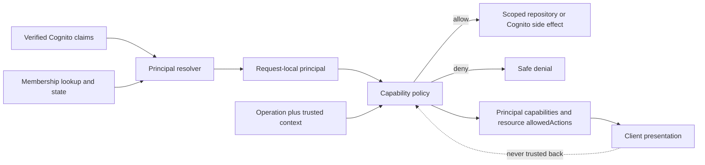

## Context

Todone has immutable Membership roles and multiple Membership activation states, with additional authorization conditions coming from self/peer relationships, household ownership, target role, credential cutoffs, and resource lifecycle. Today those conditions are expressed near each feature. The family directory already demonstrates the resulting duplication: repository visibility, handler role checks, response `allowedActions`, and UI behavior must independently agree.

OpenSpec also uses the word “capability” for product specification areas. In this change, **authorization capability** means a stable runtime action key such as `profile.self.update`; it does not mean an OpenSpec capability directory.

## Goals / Non-Goals

**Goals:** one derived principal model, one stable action registry, one contextual policy decision API, broad client presentation capabilities, resource-specific allowed actions, fail-closed enforcement, exhaustive policy tests, and a required extension path for future product work.

**Non-goals:** persisted grants, customizable roles, an external policy engine, capability-bearing client requests, removal of tenant scoping, or speculative implementation of future Todo/label/recurrence behavior.

## Architecture

### Principal model

The principal resolver consumes only verified Cognito identity and server-read Membership data. It produces a discriminated principal such as:

- `anonymous`
- `unattached`
- `active-member` with immutable role, household ID, member ID, and credential-validity facts
- `pending-member`
- `inactive-member`
- separately authenticated service/operator principals where an existing contract requires them

Protected household application routes normally require `active-member`. Pending and inactive principals can still receive a typed denial without being accidentally treated as an absent role. Principal objects and capability sets are request-local; they are not stored as authority.

### Capability registry

Authorization capabilities use stable lower-case, dot-separated action keys. The initial registry covers delivered and in-progress contracts, including:

| Area | Principal capability examples | Contextual action examples |
| --- | --- | --- |
| Household | `household.bootstrap`, `household.read` | None initially |
| Profile | `profile.self.read`, `profile.self.update` | `profile.update` on the caller's own Profile |
| Family directory | `family.directory.read` | Pending-parent actions below |
| Member creation | `family.child.create`, `family.parent.create` | None until a target exists |
| Pending parent | None as broad mutation authority | `family.pending-parent.resend-welcome`, `family.pending-parent.change-email-and-resend`, `family.pending-parent.cancel` |
| Child management | `family.child.manage` for navigation | `family.child.password.reset`, `family.child.remove` on an active same-household child |
| Parent security | `security.recovery-email.self.manage` | Self only |

The implementation SHALL define each key once in a typed registry. A key records whether it is principal-wide or requires context. Feature code does not compare raw role/state strings or invent parallel action enums.

Future Todo, label, recurrence, and other changes extend this registry only when their operation is implemented. Their OpenSpec requirements must state the key, eligible principals, contextual scope, lifecycle restrictions, response presentation, and denial tests.

### Policy decisions and context

The policy accepts a request-local principal, a registry capability, and typed trusted context when required. Context may include resolved household ownership, caller/target relationship, target role/state, assignee identity, or resource lifecycle. It returns an allow/deny decision suitable for server enforcement. Internal denial classifications may support safe metrics and tests but are never sent to clients when they would disclose hidden identity or resource state.

A principal capability is intentionally insufficient for a target mutation. For example, `family.child.manage` may display the family-management destination, but resetting a password still requires a contextual decision for `family.child.password.reset` proving that the target is an active child in the caller's household. Repository keys remain derived from the resolved household, and cross-household targets remain indistinguishable from absence.

### Server enforcement

Handlers follow one sequence:

1. Authenticate and resolve the typed principal.
2. Ask the central policy for the named operation and trusted context.
3. Deny safely before any disclosure-risk read, Cognito administration, or write when the decision is not allowed.
4. Execute a household-scoped repository operation.
5. Re-check lifecycle/version conditions at the persistence boundary where concurrency requires it.

Repositories preserve storage invariants, tenant-scoped access patterns, and conditional writes. They do not decide UI affordances or independently reinterpret parent/child permissions. IAM remains an independent outer bound on AWS operations.

### Client contract

The authenticated bootstrap/current-membership response adds a sorted, deduplicated `capabilities` array containing broad presentation capabilities available to the current principal. The client uses it for routes, navigation, empty states, and global create controls.

Representations with target-specific operations add a sorted, deduplicated `allowedActions` array using the same registry keys. The family directory therefore replaces feature-local pending action values with the corresponding shared capability keys. Resource actions reflect the caller, target, and current lifecycle at response time.

The client may optimistically hide or disable controls from these fields, but capability data is advisory. Requests never submit grants, and the server always re-evaluates because state may change after a response.

## Visual and UX Direction

- Capability-driven presentation uses the shared `visual-design-foundation`; authorization metadata changes which legitimate controls and destinations are presented, not the visual language of the page.
- Before migrating each surface, map loading, allowed, unavailable, stale-after-render, denied-after-action, session-loss, and recoverable-refresh states onto its accepted component anatomy. Do not let controls visibly pop between role guesses during initial session resolution.
- Hide actions that have no meaningful unavailable explanation. Disable an action only when persistent visible context helps the user understand a prerequisite; hidden or disabled presentation is never described as the security boundary.
- A stale-capability denial should update the current surface calmly, retain safe input where allowed, announce the outcome, and return focus to the refreshed valid action or section heading. It should not expose policy keys, target state, or another household's existence.
- Broad navigation capabilities should preserve the role priorities from the foundation: a child reaches assigned active work directly and a parent retains the prominent create-Todo path when authorized. Family administration must not become visually primary merely because it exposes more capability-driven actions.
- Review migrated surfaces at compact, medium, and wide targets, 320-pixel reflow, 200-percent zoom, keyboard/focus, and session-resolution/stale states before completing the client migration.

## Failure Modes and Concurrency

- Unknown or unregistered capability keys fail closed and are caught by static typing/tests where possible.
- Missing, pending, inactive, inconsistent, or credential-cutoff Membership state denies protected household capabilities.
- Missing context for a contextual capability denies rather than falling back to principal role.
- State can change between representation and mutation. The mutation policy and conditional persistence use current data; stale client `allowedActions` may produce a safe denial or lifecycle conflict.
- Cross-household and hidden-resource denials preserve existing not-found/non-disclosure behavior.
- Policy evaluation does not call Cognito administration or mutate persistence, making it deterministic and independently testable.

## Observability and Privacy

Authorization metrics may record route, stable capability key, coarse allow/deny outcome, and non-sensitive denial category. Logs and metrics exclude names, usernames, email, `sub`, household/member/resource IDs, JWTs, request bodies, and capability arrays tied to an identifiable request. Unknown-capability and policy-coverage failures are observable without logging private context.

## Testing Strategy

- Registry tests prove key uniqueness, stable serialization, context requirements, and complete policy coverage.
- Table-driven policy tests cover anonymous, unattached, pending, inactive, active child, and active parent principals for every current capability.
- Context tests cover self, peer parent, same-household child, cross-household target, inactive/pending target, assignee relationships, and resource lifecycle where applicable.
- Handler/integration tests prove denial occurs before repository writes or Cognito calls and that client-supplied capabilities are ignored.
- Contract tests prove principal `capabilities` and resource `allowedActions` are sorted, deduplicated, safe, and consistent with policy decisions.
- Existing security-negative tests remain in place; migrating to the policy is not a reason to weaken endpoint-level coverage.

## Migration and Compatibility

1. Define the typed principal, registry, decision API, and exhaustive policy tests without changing endpoint behavior.
2. Migrate Membership resolution and current household/profile/directory handlers to the policy.
3. Replace feature-local action enums with shared capability keys and add additive client `capabilities` fields.
4. Migrate remaining family-account handlers as they are implemented.
5. Update the authorization matrix, API/security/testing documents, `AGENTS.md`, and every active downstream OpenSpec change with the extension checklist.

No persisted data changes. Older clients can ignore additive capability fields. During migration, an endpoint moves completely to the new policy in one slice; it does not combine old and new authorization branches. Rollback restores the previous application artifact and ignores additive response fields.

## Alternatives Considered

### Persist capability grants on Membership

Rejected. Role/state changes, removal, password-reset cutoffs, and future resource lifecycle would require grant synchronization and could leave stale authority. Derived policy revokes access from current trusted state immediately.

### Return only role and state to the client

Rejected. It forces every client surface to reproduce the policy mapping and is the source of the current presentation drift.

### Return capabilities only, with no contextual allowed actions

Rejected. Broad capabilities cannot safely describe self, target role, household ownership, assignment, or lifecycle restrictions and would encourage over-broad UI assumptions.

### External policy engine or generic rules language

Rejected. The application is small, the policy is domain-specific, and a new service/dependency adds operational complexity without a current need. A typed in-process policy is boring, testable, and reversible.

## Completed request replay

Separate new-operation authorization from `request.completed.replay`. Authenticate and resolve
current principal before receipt access. Only active parents can inspect their own administrative
receipts; repository lookups bind caller, route, idempotency key, target and payload digest. A
matching completed receipt supplies trusted replay context to policy. The decision permits only
returning the completed result, including when bootstrap has attached the caller or cancellation
has deleted its target. It never permits writes, Cognito calls or missing-target mutation. Missing,
mismatched, incomplete and foreign receipts deny or retain the existing safe conflict response.
Unattached bootstrap still uses its ordinary capability; inactive, inconsistent and stale
credentials cannot replay protected results. No receipt contains a persisted grant. Existing
atomic guards, revocation and idempotency semantics remain in force.
