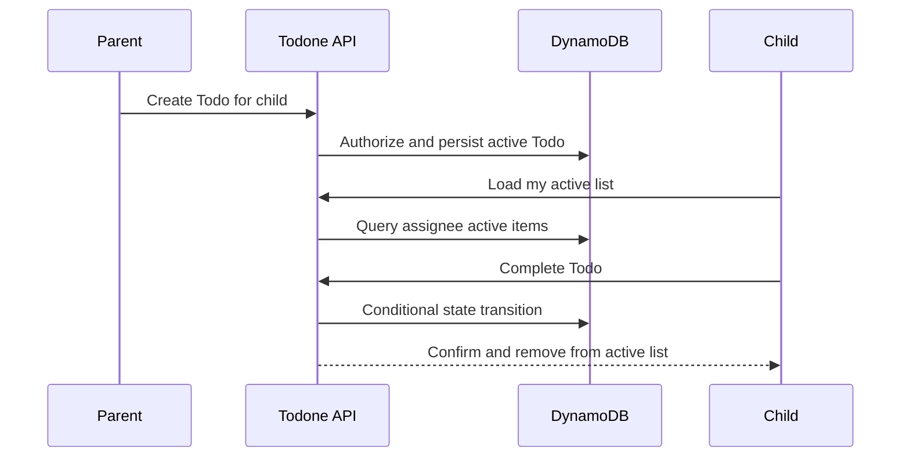

## Context

The first useful vertical slice follows established households and profiles. It needs a small state model, read access patterns for active lists, and server-side completion authority.

## Goals / Non-Goals

**Goals:** create, view, and complete one-off single-assignee Todos with durable completion metadata.

**Non-Goals:** completion reversal, edits after creation, archival/history, labels, recurrence, unassigned Todos, and multiple assignees.

## Decisions

- Todo fields include immutable ID, household ID, title, optional date-only due value, scalar assignee member ID, status, creation metadata, completion metadata, and version.
- Model `ACTIVE` and `COMPLETE`; derive overdue after household-local end-of-day from Household timezone and due date rather than storing a terminal state.
- Resolve current member display name and color from the profile when rendering. Do not write assignee identity snapshots onto Todo records.
- Use the canonical data-model/access-pattern document for assignee and household active-list queries and authorize membership before access.
- Conditional writes on status and version make completion idempotent and return the current state for double taps or stale clients.
- Use server timestamps for completion actor/time. Reversal uses the same underlying transition as parent reopen, but is deferred until the next change supplies completed/history visibility.

## Visual and UX Direction

- Use the child active list and parent member list as the first feature-level validation of `visual-design-foundation`. Create compact reference states before implementation for populated, empty, loading, overdue, submitting, completion-success, failure/retry, and already-changed outcomes, then verify materially different medium/wide composition.
- Make a child's Todo title and completion control the strongest repeated elements on a full-bleed list canvas whose accessible tonal surfaces derive from the signed-in member's canonical stable profile-color ID in `shared/profilePalette.ts`. Due status is secondary but explicit; labels and recurrence are not present in this slice. Avoid illustrated task icons, emoji decoration, rewards, and card chrome that makes each short Todo feel like a dashboard tile.
- Keep a prominent labelled create-Todo path in the parent shell and make assignee selection clear through visible name plus profile color. The creation form should feel focused even as later optional fields are added.
- On activation, the completion control may show immediate pressed/busy feedback while the row remains semantically active. Only after server confirmation should it pop, play one equally prominent nature treatment selected by hashing the stable Todo ID into the approved effect list, resolve briefly to an explicit lower-emphasis completed appearance, and collapse out of the active list within a few seconds. Do not introduce rare/jackpot outcomes or collection language.
- Completion uses no sound or vibration. Any swipe gesture is supplementary to a visible labelled control. Reduced motion removes pop, particles, translation, and animated collapse while preserving the announcement, removal, and next-focus behavior.
- Review real screenshots and motion at every responsive target, 320-pixel reflow, 200-percent zoom, and with long titles/names before completing the UI. Motion timing tests should assert a documented upper bound and outcomes, not brittle animation frames.
- Review motion on representative supported mobile and laptop browsers. Prefer composited transforms/opacity, but retain richer SVG/CSS effects when measured scrolling, input, focus, confirmed-state presentation, and removal remain responsive.

## Risks / Trade-offs

- Parent completion is allowed deliberately; it records the parent as actor rather than impersonating the child.
- No optimistic false success: client UI waits for server confirmation, trading a small delay for correct family visibility.
- A celebratory removal can disrupt orientation if it is too long or global. Keep feedback local and brief, preserve useful focus, and let the child continue with the next Todo immediately.
- Extend the family-account removal cascade for the Todo entity introduced here. Delete all active and completed Todos assigned to the child before profile/identity deletion completes and username reuse is allowed.
- Completed Todos are not rendered to parents or children in this change. The next lifecycle/history change consumes the persisted actor/time metadata for completion visibility.

## Child-removal extension contract

Register every child-associated record/history/audit type introduced here in
`lambdas/households/childRemoval.ts` (`childRemovalSteps`) and add deletion and partial-failure
coverage before this capability is complete. Keep profile/lifecycle writes conditional on active
Membership so late writers cannot recreate purged data. The approved hash-only revocation marker
blocks stale-token bootstrap after lookup deletion and expires after confirmed Cognito deletion
plus configured token lifetime/tolerance; never retain raw removed-child identity or snapshots.
