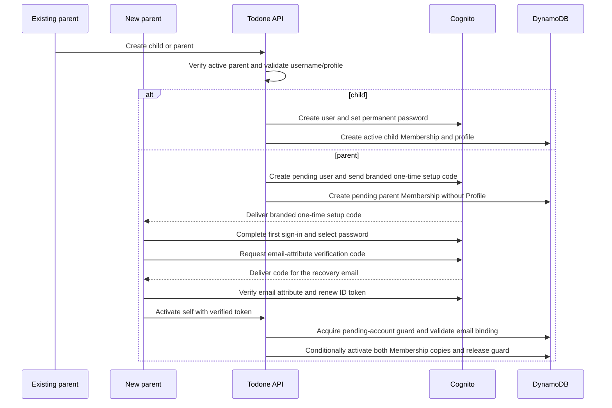

## Context

Households need parent-managed credentials for children and may contain any number of equal parent accounts. Cognito provides globally unique immutable usernames, user provisioning, verified-email parent recovery, and permanent child password reset operations, while Todone owns immutable household roles and mutable, non-unique profile data.

## Goals / Non-Goals

**Goals:** role-appropriate parent/child account creation, parent and child recovery, self-service profile identity, family management, full child removal, and peer-parent safety.

**Non-Goals:** reusable/public household-join invitations, parent removal/demotion, role mutation, shared device switching, and built-in partial-provisioning repair UI. The account-specific additional-parent welcome email is part of activation and is in scope.

## Decisions

- For children, a parent-only API creates the Cognito user with messaging suppressed, sets the supplied permanent password, then creates the Membership and profile.
- The existing pre-signup Lambda treats public `PreSignUp_SignUp` and IAM-authorized `PreSignUp_AdminCreateUser` as independent trust paths. A small pure trigger-source policy requires the Entry Code only for public first-parent signup, permits administrative creation only after the parent-only API and pool-scoped Lambda role authorize it, and rejects unexpected trigger sources. Administrative creation never depends on a previous public signup event. Tests and comments preserve this boundary.
- For parents, `AdminCreateUser` creates a `PENDING_ACTIVATION` account and Cognito emails a generated temporary credential presented to users as a **one-time setup code**. The email links to the activation route without putting username, email, code, or another secret in the URL. The new parent enters username, setup code, and a policy-compliant self-selected password; the client completes Cognito's `NEW_PASSWORD_REQUIRED` challenge. This proves account authentication, but does not prove whichever email may now be configured after an overlapping administrative change. On `/activate-parent`, request a separate Cognito email-attribute verification code with `GetUserAttributeVerificationCode`, submit it through `VerifyUserAttribute`, and renew the ID token before self activation. Creation and activation never set `email_verified=true` administratively.
- Native Cognito email OTP/passwordless sign-in and custom magic-link authentication are not used. The email-attribute verification code establishes recovery-address ownership after password setup; it does not replace password sign-in. This deliberately adds a verification step rather than inferring email ownership from a mutable invitation destination or a setup-password challenge.
- Pending parents appear in family management with status plus `Resend welcome email`, `Change email and resend`, and `Cancel pending account`. Existing parents cannot manually activate them. Resend uses Cognito's supported administrative resend behavior; cancellation removes only a pending identity and its application records.
- Use Cognito's `COGNITO_DEFAULT` email delivery and source-controlled `InviteMessageTemplate` for the reviewed HTML additional-parent welcome message. The template includes `{username}` and `{####}`, describes the latter as a one-time setup code, and links only to `/activate-parent`. The built-in 50-message daily account quota is sufficient for this private deployment. Do not add an SES developer sending configuration, custom-message Lambda, custom sender, dedicated IP, or paid delivery plan unless a later requirement changes the volume or sender-control boundary.
- Do not add a provisioning-operation state machine, automatic cross-service repair, monitoring, or parent-facing repair UI. The pending-account operation guard below is the narrow concurrency exception needed to protect activation and peer-parent safety. A Cognito/DynamoDB split outcome returns a generic request-ID failure and blocks product retry for that identity until the operator follows the documented inspection and cleanup procedure. Ordinary retries are idempotent only after the application can identify a previously completed operation.
- Enforce `parent` and `child` role immutability at the API/persistence boundary. The UI exposes no role mutation control.
- Store the immutable canonical username on Membership as a read-optimized copy of Cognito identity data. Cognito remains the global uniqueness authority. Usernames are normalized to lowercase, contain 3-24 characters from `a-z`, `0-9`, `-`, and `_`, may begin or end with any allowed character, and are immutable. Display name and palette color are non-unique current profile values editable only by that member.
- After the first parent creates a household, require profile setup before family management. Profile setup collects that parent's display name and one canonical palette color, creating the Profile omitted by the bootstrap slice.
- Use the canonical nature-inspired profile palette: `PINE` `#2F6B4F`, `FERN` `#4D7C3F`, `MOSS` `#6B7A3A`, `CLAY` `#B85C3F`, `CEDAR` `#8A5A44`, `MARIGOLD` `#966300`, `LAKE` `#337B8C`, and `DUSK` `#76507A`. Persist stable identifiers rather than arbitrary hex values. Render color with the visible member name and never as the sole identity signal.
- A parent-managed child password reset sets the new permanent Cognito password, invokes pool-scoped `AdminUserGlobalSignOut`, and advances a server-owned credential-validity cutoff. The cutoff has one canonical copy on the `USER#/MEMBERSHIP` lookup because it is an identity-session gate evaluated by every Membership resolution, not household profile data. Household authorization rejects tokens issued at or before that cutoff because Cognito token revocation alone does not make a previously issued self-contained JWT fail API Gateway signature/expiry validation.
- The focused reset form uses `/family/children/:memberId/password`, resolves the target from the authorized household directory, and clears its password on submission and every route/target transition. Its cutoff update requires an existing lookup and advances monotonically; a concurrent equal/newer cutoff is verified by a strong read. A failed password/sign-out/cutoff sequence is an uncertain partial result for manual operator handling, never a successful reset or a guarantee of token revocation. Local Cognito lacks `AdminUserGlobalSignOut`, so the local simulator returns an explicit unavailable result before any password mutation; deterministic service-boundary tests cover the successful sequence.
- Keep parent recovery email in Cognito and expose it only through that parent's security settings. The self-only GET projects the server-verified ID-token email claim; force renewal before the settings read. The active-parent-only PUT stages the `email` attribute with `AdminUpdateUserAttributes` without setting `email_verified` in either direction. Retain the old verified address until native verification succeeds, renew credentials, then read the promoted replacement. Unsupported local staging returns `503` before mutation.
- Full child removal requires confirmation and an extensible cascade. This change deletes Membership/profile, Cognito identity, and currently known child data; each downstream capability must add deletion of its child-associated entities to the same contract and tests. Authorization checks active Membership so stale sessions fail throughout. Release the username only after the complete deployed cascade succeeds.
- Do not retain historical identity snapshots for a removed child because downstream capabilities must delete that child's associated history. Existing records for active members resolve current display name and color from the profile.
- Follow the shared authorization matrix, data/access-pattern, interaction-state, and operations documents established by the foundation.

### Membership resolution and activation

- The repository exposes a typed resolution result rather than collapsing every state into `CurrentMembership | null`: `UNATTACHED` means no lookup exists; `ACTIVE` includes the validated current Membership; `PENDING_ACTIVATION` and `INACTIVE` are self states without household authority; `CREDENTIALS_STALE` means token `iat` is absent or not later than the lookup cutoff; and `INCONSISTENT` is corrupt persistence requiring an operator signal.
- `GET /api/v1/memberships/current` returns `200 {"membership": null}` only for a genuinely unattached identity and returns the established active representation only for `ACTIVE`. Pending/inactive identities receive a generic `403`; stale credentials receive `401`; inconsistent persistence receives a generic request-ID `500`. Ordinary household endpoints use the same denial mapping before domain reads.
- Additional-parent activation is the sole exception to active-Membership authorization. After password setup and native email verification, `POST /api/v1/parent-activations` resolves exactly the caller's matching pending lookup and household Membership. It accepts no body, target, household, member, role, username, email, or `sub`. Under the pending-account guard, validate the server-verified ID-token `email` and strictly true `email_verified` claims against the current email binding, then atomically change both activation copies to `ACTIVE`, remove the pending-only binding/guard, and return the ordinary active current-Membership representation. A signed token without verified email, or for an earlier different destination, cannot activate. Repeating activation as the now-active parent returns the current representation without any Cognito mutation; active children remain denied.
- Invalid stored attributes, missing referenced records, or disagreement between lookup, household Membership, and Household fail closed as `INCONSISTENT`. Public responses contain no stored values. Privacy-safe observability records only the request ID, route, status, and a coarse consistency outcome so expected authorization denial remains distinguishable from operator-relevant corruption.

### Pending-account email binding and concurrency

- At parent provisioning, persist a random binding salt, a SHA-256 digest of the length-delimited salt and exact intended Cognito email value, and a monotonically increasing pending-account version on the user lookup. Preserve the address's case; do not use a lossy lowercase comparison to authorize verification. Raw email remains in Cognito and immediate request memory only. The digest is private derived contact data: exclude it and its salt from directory/session responses, logs, metrics, URLs, and idempotency responses, and delete both on activation or cancellation. It is an equality binding, not an authentication secret or an anonymized value.
- Add one conditional operation-owner field on the pending lookup, with an unpredictable operation ID. Activation, resend, change-email-and-resend, and cancellation acquire the same guard only while the lookup and household Membership both match the expected pending parent/version. Acquisition and state checks form one DynamoDB transaction; re-read trusted target data after acquisition and before invoking Cognito. This works across Lambda instances and local concurrent requests; an in-process mutex or a preflight read alone is insufficient.
- Hold ownership across the entire external operation and final conditional write. Email change updates Cognito with `email_verified=false`, completes the supported resend, and conditionally commits the new digest and next version before releasing the guard. A provider-retained old verified address or a previously issued token for that address does not match the new binding. Resend never verifies an email. If Cognito refuses resend after password setup, report that outcome without claiming that a replacement was delivered or allowing activation against an uncertain binding.
- Activation commits both pending-to-active copies only with the same owner, version, and email binding. If activation wins, subsequent pending-account administrative requests fail before Cognito, including cancellation. If email replacement wins, activation must use proof for that new address; a cached verified claim for the earlier address is insufficient. If cancellation wins, activation fails without recreating records. Cancellation keeps the guard until application cleanup and Cognito deletion are confirmed, then removes the guarded lookup in its final conditional transaction; never release authority for a delayed cancellation to delete an active peer.
- A contending request returns a safe `409` already-changed/busy outcome without side effects; completed idempotent replays preserve their endpoint's existing success contract. Refresh authorized state before another explicit action. Guard ownership is checked on every final write and release. Do not expire, steal, or automatically clear a guard: a timed-out Cognito request may still complete after a lease expires, and Cognito does not enforce DynamoDB fencing tokens.
- Release a guard only after confirmed success, confirmed side-effect-free failure, or a rejected activation proof with no external mutation. Retain it after an unknown external outcome or a crash. The operator runbook must quiesce the affected handler/in-flight work, inspect both systems, reconcile the binding and Membership state, and conditionally clear the exact owner only after repair. No generic retry, TTL deletion, rollback, or old build may remove it and let a delayed writer regain access.
- Pending records missing binding/version metadata cannot use activation or pending administrative actions. There is no safe way to infer that an old setup challenge proved the current email. Recreate or repair them through the authorized operator procedure. Rollback must keep the new guard-aware handlers or disable these endpoints until repaired; do not return to username-only email verification.
- The shared authentication boundary carries `email` and `email_verified` only from API Gateway's verified claims or the configured JWT verifier, handling the gateway's documented claim representation explicitly. Request bodies, decoded-but-unverified tokens, access-token/ID-token substitutions, client state, and a successful password callback do not supply this proof. Keep contact claims ephemeral and out of logs and ordinary current-session responses. Pass the session/storage dependencies through challenge completion, verification, and token renewal, including retries, so the real SDK cannot persist secrets in default storage or publish credentials from an obsolete session generation.

### Verification and provider boundaries

- Add deterministic two-request interleaving tests for activation versus email replacement, resend, and cancellation in both orders, plus guard acquisition/release conditions, repeated activation, stale signed claims, missing claims, and partial Cognito/DynamoDB outcomes. Include a suspended external request that finishes after another request attempts to acquire ownership; no timeout can create overlapping writers.
- Exercise the real authentication adapter with supplied storage through `NEW_PASSWORD_REQUIRED`, email verification, and renewal. Verify that refreshed signed claims, rather than a mocked UI success, drive activation and that session replacement/sign-out discards late results. Preserve API Gateway and local-verifier parity for claim validation and deny before any side effect.
- Prove that native verification for the earlier email cannot activate the replacement address, including changes while the password challenge or verification request is in flight and staged provider updates that retain the old address. The local emulator must enforce the same gate or explicitly report that activation is unsupported before granting authority. Real AWS verification/delivery semantics remain a named human release check if the emulator cannot establish them.
- Update the canonical API, authorization, data-model, threat-model, UX, testing, and operations documents before the activation slice. Add the email-verification step, pending-only binding lifecycle, guard conflict/uncertainty outcomes, claim-handling rules, operator recovery, and guard-aware rollback to those contracts. Previously completed adapter work is not evidence that the unsafe verification helper meets this revised design.

Provider references: [email-attribute verification](https://docs.aws.amazon.com/cognito-user-identity-pools/latest/APIReference/API_VerifyUserAttribute.html), [requesting a verification code](https://docs.aws.amazon.com/cognito-user-identity-pools/latest/APIReference/API_GetUserAttributeVerificationCode.html), and [administrative updates and staged attributes](https://docs.aws.amazon.com/cognito-user-identity-pools/latest/APIReference/API_AdminUpdateUserAttributes.html). Cognito owns address/code verification; the application must still bind the verified address to the current pending account and coordinate its own administrative writers.

### Deleted-identity revocation and child-removal cascade

- Owner-approved correction (2026-10-20): removing the lookup must not turn an old valid JWT into an unattached first-parent identity. Before a child lookup can disappear, atomically deactivate both Membership copies and write a revocation record at `REVOKED#<SHA-256(sub)>/REVOCATION`. Store only the hash key, random removal owner while work is pending, and a numeric `expiresAt` after confirmed deletion; never store raw `sub`, member ID, username, name, email, profile data, or payload in that marker. Pending-account cancellation publishes the equivalent expiring marker atomically with its application-record deletion after confirmed Cognito deletion.
- Membership resolution and bootstrap check the revocation key before treating an absent lookup as unattached or replaying a bootstrap. An in-progress removal marker has no expiry and remains fail closed after partial failure. After complete application cleanup and Cognito deletion, replace its owner with an expiry of confirmed-deletion time plus the explicitly configured one-hour ID-token lifetime and 60-second clock tolerance. Never start that window before Cognito deletion: the identity may still obtain tokens while cleanup is pending. Username reuse has a new `sub` and is unaffected.
- Logically expire the marker at its bound regardless of DynamoDB TTL delivery lag; conditionally purge it on reads and enable physical TTL cleanup on `expiresAt`. Guard records have no TTL field and never expire. The pinned shared table module lacks a TTL input, so vendor its exact table resource/inputs/outputs inside this repository and add only the TTL block, retaining `module.table.aws_dynamodb_table.this`, table name/keys, PITR, encryption, and deletion protection. This adds no service or provider dependency and avoids changing the shared repository. A reviewed plan must show no table replacement; apply/deploy remain prohibited.
- One typed child-removal registry owns deletion of Profile and completed child-provisioning replay references today. Each later child-associated entity registers a deletion step and failure/security-negative tests before release. Discover creation replays with paginated parent-partition queries, never a table scan; remove references to the child's member ID. Delete the inactive household Membership and lookup only after every registered step succeeds, then delete Cognito, finish the revocation bound, and write a parent-owned completed removal replay containing only normalized digests. An uncertain result is not automatically repaired or retried.
- Verify active-parent/same-household/active-child target and explicit confirmation before every side effect. Concurrent removal/reset cannot revive a missing or inactive lookup. Test deletion failures at every boundary, old tokens attempting fresh household creation (including concurrent bootstrap during lookup removal), completed replay, reusable username with unrelated new identity, and logical/physical marker expiry. Expiring revocation metadata is the explicit deletion-retention exception; no raw child identity or historical snapshot survives successful removal.

### Routing and browser history

- Use one client-side router as the source of truth for page-level navigation. Component-local state may control temporary disclosure and dialogs, but it SHALL NOT represent a distinct page that users reasonably expect to bookmark, reload, or revisit with browser Back/Forward.
- Complete this routing slice before shared visual-foundation implementation or additional family-account UI. Routing first isolates navigation, authorization guards, and secret-clearing behavior from the later visual refactor.
- Use `vue-router` as the conventional Vue 3 routing dependency and source of truth. Use the canonical public routes `/sign-in`, `/register`, `/verify-email`, `/forgot-password`, `/reset-password`, and `/activate-parent`. Use the canonical authenticated routes `/todos`, `/household/setup`, `/profile/setup`, `/family`, `/profile`, `/security`, `/family/children/new`, and `/family/parents/new`. `/` resolves the current authenticated/onboarding state and replaces itself with the appropriate canonical route rather than adding a redundant history entry.
- Until the first Todo vertical slice ships, `/todos` is a nonfunctional work-in-progress page. An active child with a Profile lands there. It contains no fabricated Todo records, completion or creation controls, disabled promises of future actions, or Todo API calls. Parents continue to land on the nearest currently useful authorized surface; the later Todo slice may make `/todos` their home when real household/member lists exist.
- Ordinary link/button navigation pushes a history entry. Automatic normalization and authorization/onboarding redirects replace the current entry. Back and Forward restore the corresponding safe surface without replaying a mutation, resubmitting a form, or resurrecting secret input.
- A reload or direct visit resolves the current Cognito session, Membership, role, activation state, and Profile before rendering protected content. Signed-out users are sent to `/sign-in`; missing household/profile prerequisites are sent to their required setup route; unauthorized, stale, or unknown family routes fall back to the nearest safe canonical route without revealing whether another resource exists.
- Route paths, query strings, fragments, and persisted history state contain no password, Entry Code, verification code, one-time setup code, token, recovery email, submitted email, or username. Verification, reset, and activation routes collect required identity and secret values again in current in-memory form state when necessary.
- Route transitions set a meaningful document title and move focus to the destination heading or an intentional error summary. A destructive confirmation may remain a modal over its owning route; opening, canceling, confirming, or traversing history SHALL never imply that a write occurred before the server confirms it.

## Visual and UX Direction

- Apply `visual-design-foundation` before final family-management styling. Explore the compact family directory, first-parent profile setup, child creation, pending-parent state, and self-profile editing with realistic long names, usernames, role/state metadata, and authorized actions.
- Create the pre-implementation family-account reference as a quick self-contained HTML page under `docs/ux/references/`, present it to the product owner for human review, and retain the accepted page as a decision reference. It is not a production route or a post-implementation validation surrogate.
- Keep member identity warm but restrained: name is primary, canonical profile color is a compact supporting cue in shared directories, and username/role/state form a consistent metadata line. On that member's own home and Todo surfaces, an accessible derived tonal family may influence the header and full-bleed canvas without applying the raw base hex or changing semantic action/status colors. Do not introduce avatars, animals, illustrated identities, or profile-color-filled directory cards.
- Use progressive disclosure for administrative complexity. On compact layouts, the directory is a continuous full-width member list rather than stacked cards; row navigation remains link-like, while password reset, resend/change/cancel, and destructive removal remain clearly labelled buttons because they initiate actions. Recovery email and focused forms open on their own route or confirmation surface instead of expanding every row into a settings panel.
- Treat every focused page-level form in the canonical route map as a real navigation destination. Reference states SHALL show route transitions and the expected Back destination as well as the visual composition.
- Preserve a prominent route from the parent shell to Todo creation once that capability exists. Family management remains reachable but must not become the default parent home solely because it contains more controls.
- Review pending, active, provisioning, partial-failure, session-cutoff, and destructive-confirmation compositions before implementation. Deep forest, profile-derived context, and warm form surfaces should organize the density without using status color as the only signal.
- Extend the accepted `/activate-parent` reference with a separate labelled email-verification-code step after password setup, resend-code controls, invalid/expired-code feedback, stale-destination recovery, busy/conflict, and uncertain-operation states. Keep the focused compact surface continuous, preserve safe input/focus where possible, and clear codes on submission/navigation/session changes. A successful password step must not display activation success or household content. Update welcome instructions to distinguish the setup code from the later email-verification code and account for both in quota guidance.
- Perform visual review on actual UI and the branded welcome email. Verify long-content wrapping, keyboard/focus order, 320-pixel reflow, 200-percent zoom, reduced motion, and every palette/text combination before completing the feature UI.
- For post-implementation product-owner review, provide concise UX journeys that name the starting role/state, canonical route, actions, and expected visible/focus/navigation result. The product owner reviews the real app through those journeys; no second post-implementation mockup is required.

## Risks / Trade-offs

- The runtime needs privileged Cognito operations; IAM must scope actions to the Todone user pool and all authorization occurs before calling Cognito.
- `AdminCreateUser` is IAM-authorized and is not callable through the public browser app client. A compromise of the Lambda role is therefore the relevant administrative-creation threat; least-privilege pool scoping and parent authorization are mandatory.
- Permanent passwords make child onboarding simple but require strong transport security and strict no-log handling.
- Cognito's built-in email sender has a non-adjustable 50-message daily account quota. That is sufficient for this private deployment and avoids separate SES sending configuration; exceeding it fails delivery and requires waiting for quota reset or a later reviewed move to SES. Infrastructure review must reject an unintended Cognito tier upgrade or paid email configuration.
- Full deletion crosses Cognito and DynamoDB without a shared transaction. If it partially fails, fail closed through active-membership checks and use the operator runbook before releasing the username.

## Local wipe and seeded review household

- `npm run db:reset:local` requires the frontend, local API and Cognito emulator to be stopped.
  Check both loopback address families for ports 3001, 3002 and 9229 before deleting anything;
  refuse active listeners rather than stopping unknown processes or SSH forwards.
- Delete only repository-anchored ignored `.cognito/db/` and the generated local seed manifest;
  reject symlinked parent/target paths. Preserve tracked emulator configuration and unrelated
  `.env.local` settings. Reject production mode, remote endpoint overrides and unreviewed emulator
  network configuration before cleanup. Use fixed local dummy credentials and loopback delivery.
- Own a temporary Cognito emulator while provisioning fixtures; always stop it on completion,
  error or interruption. Recreate local clients and identities, write fresh non-secret local
  configuration, and publish the ignored versioned seed manifest only after provisioning succeeds.
  A failed reset exits nonzero and leaves no usable partial seed manifest.
- The manifest contains only fixture usernames, actual emulator `sub` values and the bound local
  pool identifier. It contains no password, email, token or code. The API loads it before listening,
  only with explicit local-development configuration, validates its fixed fixture identities and
  pool binding, and initializes both Membership copies and Profiles through repository operations.
  Fixture parents start active by deliberate seed construction, not through the activation API.
- Rebuild the in-memory household from that manifest on API restart. Edits and additionally created
  household data remain ephemeral; Cognito identities persist until the explicit wipe. Browser
  storage is outside the reset boundary; close old tabs/sign out after a reset with changed clients.
- Keep native activation/recovery/reset unsupported gates intact, and test both seeded parents'
  actual emulator sign-in, shared household access, self-only profile rules and peer-management
  denial. Do not expose an HTTP seed/reset endpoint or import fixtures into production handlers.

## Owner review: invite identity and first-login profile

- Parent creation accepts exactly username/email and idempotency key; do not write a Profile or
  include display name/color in the creation digest. Existing child creation is unchanged.
- Directory profile fields are optional for parents without a Profile (pending or newly active).
  Render username and explicit pending/setup status without a fabricated color/name. Missing child
  Profiles remain inconsistent. Creation replays find the same pending member without a Profile.
- Preserve native verification and activation ownership. After activation, existing session context
  reads a null Profile and requires `/profile/setup`; its self-only version-zero create supplies
  name/color. Cancel pending accounts conditionally deletes an absent or legacy-present Profile.
- Development seed parents explicitly receive their own fixture Profiles after fixture activation.
  No invitation API accepts fixture-only profile data. Group child reset navigation and removal
  mutation controls in one flex action container with equal target height and vertical alignment.

The local second-parent fixture now starts active with no Profile so the owner can test first-login
self-profile setup without real email delivery. First-parent/child fixture Profiles remain configured;
the seeded browser test completes the second parent's own setup before testing family permissions.

### PR review: invitation eligibility and activation recovery

Under exclusive pending ownership, read Cognito AdminGetUser by immutable sub and allow
welcome/email-and-resend only for enabled FORCE_CHANGE_PASSWORD identities. Release the guard
after read-only failure or ineligible state before any mutation. A password-setup race may still
produce a definitive resend invalid-state rejection: release only for resend with no prior email
mutation. Throttled pure resend also releases; unknown sends and email-update/resend splits remain
locked for quiesced operator repair. Provider status stays private and never grants activation.

On entry/restoration of a pending session, renew credentials and try self activation without a code.
Only EMAIL_VERIFICATION_REQUIRED shows the verification form. After submitting a code, retry
activation independently even if native verification consumed the code and renewal failed. A
conflict refreshes authorized context; conflict/network failures show an explicit activation retry,
with no automatic mutation loop. Every continuation checks captured session generation. No local
verified flag or persisted draft authorizes activation; server binding validation remains final.
