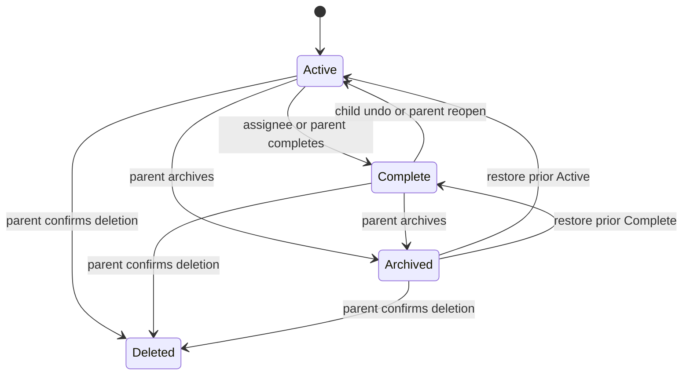

## Context

The first Todo slice contains active and complete work only. This change adds correction, archive, history, and permanent deletion while retaining a clear distinction between reversible archival and irreversible removal.

## Goals / Non-Goals

**Goals:** parent lifecycle control, child completion correction, durable role-scoped history, and safe concurrent updates.

**Non-Goals:** recurrence states, child metadata editing, multiple/unassigned ownership, labels, bulk operations, and time-based retention expiry.

## Decisions

- Preserve one Todo record and lifecycle audit fields rather than copying history into a separate mutable document. Store `preArchiveStatus` while archived so restore is state-preserving.
- Maintain active and historical query projections keyed by assignee and household.
- Store versioned conditional writes for edit, archive, restore, product deletion, completion, undo, and reopen. Undo and reopen share one completed-to-active operation with role-specific authorization.
- Permit title, date, and assignee edits only while active; overdue remains active and is derived. Completed and archived metadata is immutable, and archived records accept only restore or parent deletion.
- Resolve assignee and completion actor display identity from current profiles. Full child removal deletes associated work/history, so no removed-member profile fallback is required.
- Children receive history queries only for their own current assignee ID. They may undo only a completion they performed on a Todo still assigned to them.
- Product deletion removes all user-visible projections and writes a restricted full audit snapshot containing the deleted Todo and completion metadata. Product APIs never expose this snapshot. Full child-account removal purges audit snapshots associated with that child.

## Visual and UX Direction

- Extend the accepted Todo-row anatomy from `visual-design-foundation` instead of creating a separate history theme. Explore active, completed, archived, overdue, conflict, and removed-item states with realistic actor/time and assignee metadata before implementation.
- History should feel quieter than current work: status, actor, and time remain legible, while completed and archived rows use restrained contrast and no celebratory motion. A completed row briefly shown during active-list completion is transitional; durable completed records live in the role-authorized history surface.
- Keep correction actions contextual and progressively disclosed. Reopen/undo and restore are available where eligible; archive is the normal reversible removal; product deletion remains visually separated, low-frequency, and behind a focused confirmation.
- Preserve chronology as both visual and DOM order. Use spacing, section headings, and compact metadata rather than a card around every historical event.
- Prototype and review empty, loading, filtered/role-scoped, conflict/already-changed, destructive confirmation, and error/retry states at compact and wide compositions before final styling. Verify focus after list removal/restoration, long content, reduced motion, zoom/reflow, and status contrast on the actual UI.

## Risks / Trade-offs

- Product deletion conflicts with “keep history forever”; archive is surfaced as the default, deletion needs a confirmation dialog, and a restricted audit snapshot preserves operator accountability without remaining visible to the family.
- Concurrent edits require explicit refresh messaging rather than last-write-wins data loss.

## Migration Plan

- Extend existing Todo records with a default `ACTIVE` or `COMPLETE` lifecycle status, version, optional `preArchiveStatus`, and audit-snapshot path.
- Deploy read compatibility first, then lifecycle write routes and UI.
- Roll back by disabling new routes/UI; restoration of a product-deleted record requires an explicit operator process from its restricted audit snapshot and is not a user feature.

## Child-removal extension contract

Register every child-associated record/history/audit type introduced here in
`lambdas/households/childRemoval.ts` (`childRemovalSteps`) and add deletion and partial-failure
coverage before this capability is complete. Keep profile/lifecycle writes conditional on active
Membership so late writers cannot recreate purged data. The approved hash-only revocation marker
blocks stale-token bootstrap after lookup deletion and expires after confirmed Cognito deletion
plus configured token lifetime/tolerance; never retain raw removed-child identity or snapshots.

## Required central authorization integration

Delivered protected operations must extend `shared/authorizationCapabilities.ts` and the central
policy. Register a stable key, eligible principals, trusted household/self/target scope and
lifecycle restrictions before implementation; do not recreate role/state authorization in
handlers, repositories or UI. Update the authorization matrix and add policy tables plus endpoint
security-negative/side-effect-order tests. Broad capabilities and contextual `allowedActions` are
server-produced presentation hints only. Preserve conditional writes, scoped queries and
non-disclosing denials. Completed retries require caller-bound completed-receipt decisions, never
new side effects against missing targets. Service/scheduler principals need an explicit separate
policy boundary and must not inherit user grants.
